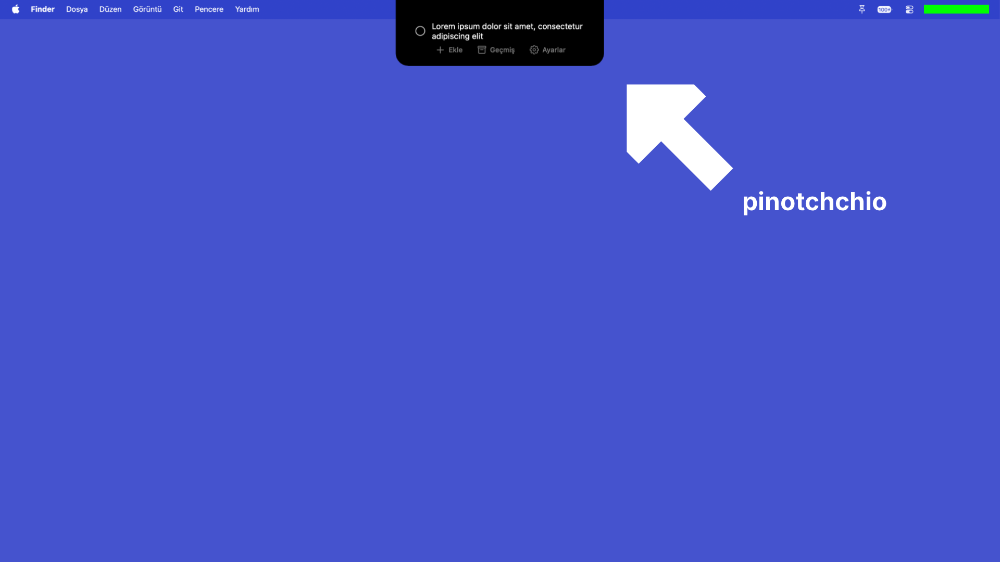

# pinotchchio

A macOS app that turns your MacBook's notch into a pure-black (♠️) drop-down to-do list. No dates, no details, just a tick -yes, tick- and a title. Tested on a 16-inch MacBook Pro.

## Running it

1. Open `pinotchchio.xcodeproj` in Xcode.
2. Press ⌘R.
3. Click the notch to expand the list, click again or press `Esc` to close.

Tasks can be ticked off to send them to History, double-clicked to edit, or clicked 4 times to delete. Data never leaves your Mac and is stored locally in `~/Library/Application Support/NotchTodo/data.json`.

Adding a language (English, Türkçe, Español and Français are built-in) doesn't require code changes — just drop a translated JSON file into the `Languages/` folder.

## Project structure

| File | What it does |
|---|---|
| `PinotchchioApp.swift` | Entry point. No windows or Dock icon — accessory app setup. |
| `NotchController.swift` | Notch dimension detection, popover panel, menu bar item, and mouse event handling. |
| `TodoView.swift` | The UI shape, task list, and individual row formatting. |
| `SubPages.swift` | The History and Settings pages that slide into view. |
| `TodoStore.swift` | Task state, history array, and local file persistence. |
| `Settings.swift` | App preferences, including launch-at-login and Liquid Glass toggles. |
| `Localization.swift` | JSON parser that loads translations from the `Languages/` directory. |

## Disclaimer

No pre-compiled .dmg is provided, meaning this project must be built manually via Xcode. This software is provided exactly as-is without any warranties. If compiling or running this code causes system damage, data loss, or any other issues, absolutely no responsibility is accepted, and all risks are entirely assumed by the user.

## License

GPL-3.0